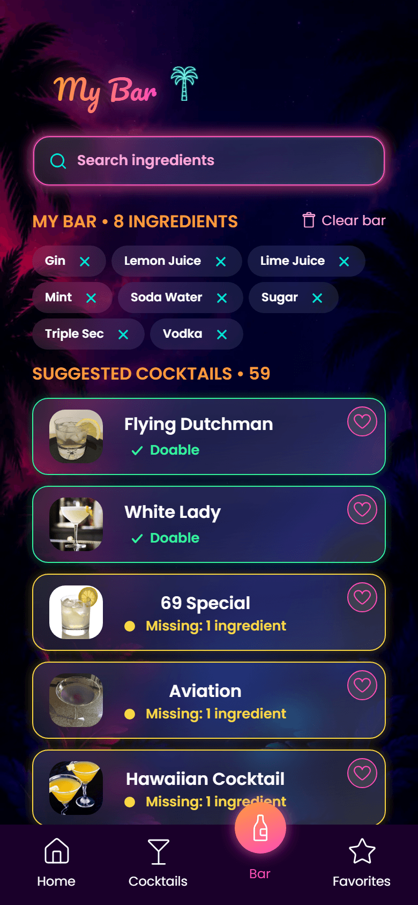
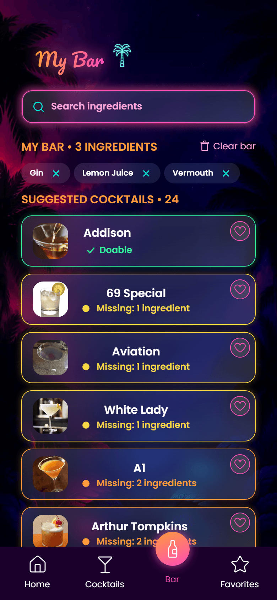
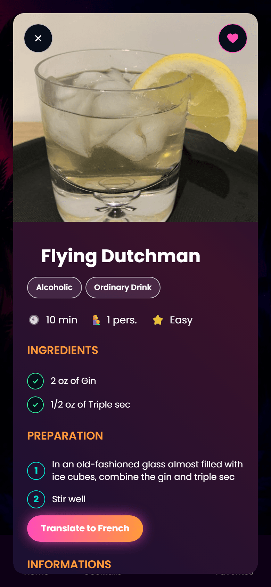
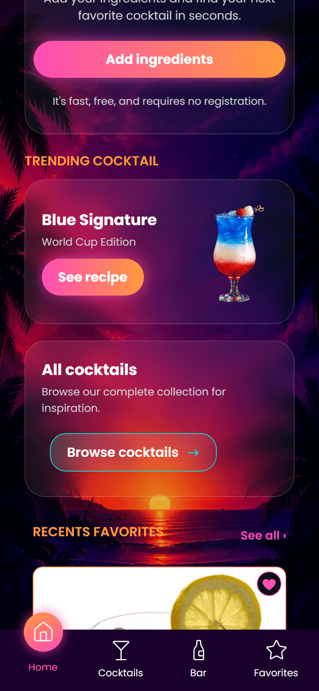
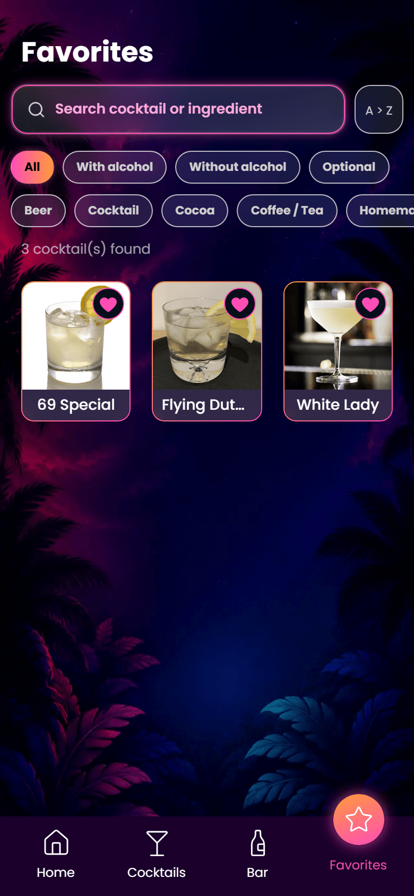

# Captain Cocktail

Tells you what you can actually make from the bottles you already have.
Add your ingredients, and the app ranks every cocktail by how far you are
from being able to pour it.

**[Live demo](https://captain-cocktail.netlify.app/)**

<p align="center">
  
  
  
</p>

<p align="center">
  
  
</p>

## Why

Recipe sites work the other way round: you pick a cocktail, then discover
you're missing three things. Captain Cocktail starts from your shelf. It
shows what's within reach first, then what you could make by buying one
more bottle — which turns out to be the useful question on a Friday night.

## Features

- **Your bar** — build a list of what you own, with search and an
  ingredient picker backed by TheCocktailDB.
- **Ranked suggestions** — every cocktail is scored by how many
  ingredients you're missing, with a colour code from "pour it now" to
  "not tonight".
- **Cocktail details** — full recipe, glass, measures and preparation
  steps in a dialog.
- **Favourites**, kept between visits in local storage.
- **Trending and themed selections** on the home page.
- **A house cocktail.** "Blue Signature" is ours, not TheCocktailDB's —
  it's injected locally and routed around the API.

## Stack

React, TypeScript, Vite, React Router, SASS (CSS modules + a shared style
layer), TheCocktailDB API. No back-end: the app is pure front-end over a
public API.

## Running it locally

Requires Node 20+ and a TheCocktailDB API key.

```bash
git clone https://github.com/fredericbriand/captain-cocktail.git
cd captain-cocktail
npm install

cp .env.sample .env
# set VITE_API_KEY to your TheCocktailDB key

npm run dev
```

```bash
npm run check   # Biome + type checking
npm run build   # production build
```

## How it works

**Matching is the heart of it.** TheCocktailDB returns ingredients as
fifteen flat fields (`strIngredient1` … `strIngredient15`) rather than an
array, so the matcher rebuilds the list, compares it against the user's
bar case-insensitively, and returns a missing count. That count drives
both the sort order and the colour of each card — one number, two
behaviours, computed in one place.

**State lives in four contexts** — the bar, the favourites, the open
cocktail and the sort order — so no component owns data that another one
needs.

**Styling is layered.** A shared `styles/` directory holds variables,
mixins, colours, reset, animations and media queries; each component then
owns a `.module.scss` beside it. Component styles can't leak, and the
shared layer stays the single place where a decision is made.

**Icons are React components.** SVGs are wrapped behind a single `Icon`
component so size and colour follow the surrounding text instead of being
baked into each file.

**Favourites persist** in local storage, read once on mount and written on
every change.

## Team and my role

Built by a team of 4 as our second project at Wild Code School.

I wrote 84 of the 201 commits. My scope: the front-end architecture
(routing, SASS layering, icon system), the ingredient-matching logic and
the suggestion ranking, the bar context, and the search and dropdown
components. I also did the final design pass across the pages.

Work was tracked per user story, with one branch per story and review by
pull request.

## Status

Training project, delivered 2026. Not actively maintained.
